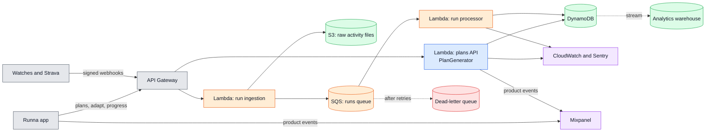

# Training Plan Scheduler: System Design
 
This document explains hypothetical run of the scheduler as a real service on AWS for an app the size of Runna. It's a design to explain thinking about the system, but it's not built in this repo. The code design is in [DESIGN.md](../DESIGN.md).
 
## 1. Context
 
The repo has the **core** logic: `PlanGenerator`, the session rules and the missed mileage adaptation. It's plain Python and doesn't know anything about databases, APIs or the command line.
 
Everything that uses it is a thin **shell** around it:
- the CLI (`python -m scheduler`), which already exists
- an API, which is what this doc describes
Both call the same generator, so the same logic can run in the CLI, Lambda or containers without rewriting it.
 
## 2. Requirements
 
**What the service needs to do:**
- **Create a plan:** runner picks a goal, race date and training days and gets a plan back
- **Show the plan:** the app shows the current plan week by week
- **Log runs:** runs come in from the app, watches and Strava
- **Check progress:** show if the runner is on track this week, and check for a shortfall when a week is finished
- **Adapt on request:** if there's a shortfall the runner gets offered an adaptation, and it only happens if they say yes
**Skip (for this exercise):** accounts and login, payments, the app UI, pace suggestions
 
**How well it needs to work:**
- Creating a plan should feel instant (a second or two)
- Processing runs can be a bit delayed (seconds or minutes, but not too long), which means I can use a queue
- Runs can never get lost. A late processed run is better than a lost one
- Plans should still be readable even if the generator is down, so plans are stored and not generated every time
## 3. Scale
 
Rough numbers, not exact:
- **~1 million monthly active runners**, worldwide
- **~3–4 runs per runner per week** (about half of users are beginners, probably on 3 day plans), so **~3–4 million runs a week**
- **Busiest hour: ~40–50 runs a second:**
  - lots of runs happen on weekend mornings and weekday evenings: ~40% of runs are at weekends, and ~20% of a weekend day's runs land in its busiest hour
  - events like parkrun make lots of runs finish at the same time
  - but they come from time zones all over the world (most users are probably still in the UK)
- **Short bursts: ~100–150 runs a second**, which the runs queue absorbs (more details below)
- Plans are created rarely, a few per runner per year, so ~0.13 plans created a second on average with spikes like New Year
- Not much data per runner in the database: a plan is a few hundred sessions and runs are a few records a week. Most of the data is the raw activity files (GPS, heart rate), which go to S3. The real app would store more per runner (e.g. shoes, strength sessions), but it would follow the same pattern: keyed by runner, small records
**Conclusion:** the main load is logging runs, and the load increases with busy periods. I think services should scale on their own (low cost at quiet times and scaling up at busy times).
 
## 4. Architecture
 

 
**Legend:**
- grey = where requests come in
- blue = plans
- orange = runs coming in
- red = failed runs
- green = storage
- purple = monitoring and analytics
| Component | What it does |
|---|---|
| **API Gateway** | Entry point for all requests, handles HTTPS and rate limits |
| **Lambda: plans API** | Creates plans, returns progress and adapts plans |
| **Lambda: run ingestion** | Checks the webhook is real, checks the run, saves the run raw file, puts the run on the queue and replies before processing |
| **S3: raw activity files** | Keeps the full file for each run (GPS, heart rate, splits), which is too big for DynamoDB. Can also be useful if runs ever need reprocessing |
| **SQS: runs queue** | Holds runs during busy bursts and makes sure no run gets lost while processing is working |
| **Lambda: run processor** | Takes runs off the queue and saves them, skipping duplicates |
| **Dead-letter queue** | Where runs end up if they keep failing, so they can be checked and replayed |
| **DynamoDB** | Stores runners, plan versions and runs, all keyed by runner |
| **Analytics warehouse** | Copy of the data for analysis across all runners (e.g. Snowflake) |
| **CloudWatch and Sentry** | Logs, metrics, alarms and error details |
| **Mixpanel** | Product analytics, how runners actually use plans and adaptation |
 
## 5. Main flows
 
### Creating a plan
1. App sends `POST /plans` with the goal, race date, training days, long run day and recent race result
2. Plans Lambda creates `Runner` and `RaceGoal` (so all the input checks run) and calls `PlanGenerator().generate_training_plan(...)`
3. If there's a `ValueError` (race too soon, wrong training days) it returns a **400** with the same message as the CLI
4. Plan gets saved as **version 1** and set as the runner's `active_plan_id`
5. Plan goes back to the app as JSON
### Logging a run
1. A run comes in from the app, or as a webhook from a watch or Strava
2. Ingestion Lambda **checks the webhook signature**, checks the run, **saves the raw file to S3**, puts the run summary and the S3 location on the queue, and replies straight away
3. Run processor saves it as a `CompletedRun`, but only if the same run (runner, date and source id) isn't saved already. So if the same run arrives twice, it only gets saved once
4. If saving fails, SQS retries it. If it keeps failing it goes to the **dead-letter queue**
### Checking progress
1. App asks for the runner's progress
2. Plans Lambda loads the latest version of the active plan and the runs for the weeks it needs
3. **This week so far:** compares km run with km planned up to today and returns "on track" or "falling behind" (`week_progress`, designed but not built yet)
4. **Last week:** runs `is_shortfall(week, runs)`. If it's true the app offers to adapt the plan
Progress is **calculated when needed**, not stored, so there's nothing to keep in sync.
 
### Adapting a plan
1. Runner says yes and the app calls `POST /plans/{plan_id}/adapt`
2. Plans Lambda loads the latest version and that week's runs and calls `adapt_training_plan(plan, week_index, runs)`
3. The result is saved as the **next version**. The save only works if that version doesn't exist yet, so if the runner taps twice, the second one fails safely
## 6. Data model (DynamoDB)
 
Everything the app asks for is about one runner, so everything is keyed by `runner_id`.
 
| Table | Partition key | Sort key | Holds |
|---|---|---|---|
| **Runners** | `runner_id` | – | training days, long run day, recent race result, time zone, `active_plan_id` |
| **Plans** | `runner_id` | `PLAN#<plan_id>#V<version>` (e.g. `PLAN#half-2027#V0002`) | goal, start date, weeks and sessions as JSON, when it was created, why ("generated", "adapted after week 5"), generator and config versions. One item per plan, query takes the newest |
| **Runs** | `runner_id` | `<local run date>#<source_id>` (e.g. `2027-01-12#strava-123`) | distance, source (app, Garmin, Strava), source id, S3 location of the raw file |
 
## 7. Handling failures
 
| Problem | What happens |
|---|---|
| Processing a run fails | SQS retries. After a few fails it goes to the dead-letter queue and an alarm goes off. Once the problem is fixed, the runs get replayed back onto the main queue |
| Run handling logic changes (e.g. a bug in distance calculation) | Runs can be reprocessed from the raw files in S3 |
| Plan generation fails | API returns a clear error and the app can try again |
| DynamoDB is slow | Runs just wait in the queue for longer. The run processor has a max number of copies so it doesn't overload the database |
| Adapting a plan fails halfway | Current version isn't touched, the new version is only saved when it's complete |
 
## 8. Monitoring
 
- **CloudWatch:** logs and metrics for every Lambda, with alarms for the dead-letter queue having anything in it and for error rates going up
- **Sentry:** catches errors with all the details (input, runner, stack trace) so bugs are easy to reproduce
- **Business metrics:** plans created per hour, runs logged per hour, and % of weeks with a shortfall. If the shortfall % suddenly changes it could be a bug in the rules, not just the code
- **Mixpanel:** events like "plan created", "shortfall offer shown", "adaptation accepted" and "adaptation declined". Tracking if runners use app features and their success rate
## 9. Rolling out rule changes and new features
 
- New versions of the rules or new features go behind a **feature flag** (e.g. Statsig) and only a small % of runners get them at first, e.g. 5%
- Compare both groups on sessions completed, shortfall rate and how often runners adapt
- If it's worse, turn the flag off without redeploying. If it's better, roll it out to everyone
- Every plan saves the generator and config versions it was made with, so I can always trace which rules made it
## 10. Trade-offs
 
| Choice | Why | What I gave up |
|---|---|---|
| **Lambda** instead of containers (ECS) | Scales on its own, costs nothing when not used, works well for a fast rule-based generator. Even at a 150 runs/s burst, only ~15 Lambdas would run at once, far below the default limit of 1,000 | Cold starts and limits on big dependencies. If the generator gets ML models, long optimisation, slow cold starts, gets too big for Lambda or the app grows larger, I'd move generation to containers (ECS). The generator is its own library, so this wouldn't need a rewrite |
| **DynamoDB** instead of a relational database | Plans and runs are always looked up by runner, which is a fast key lookup. A real app would probably also use a relational database (e.g. RDS) for data with more relationships, like accounts and subscriptions | Harder to do queries across all runners. Analysis would go through the warehouse instead |
| **Whole plan as one item** | One read and one write, and versions are easy | Can't query single sessions across runners in the main database |
| **Progress calculated when needed** | Simple, nothing extra to store | Updates only when app open |
| **Coach config in code** | Every change is tested and reviewed before it goes live | Coaches need an engineer for every change |
 
## 11. Next steps
 
- **End of week notifications:** store the weekly status and run a scheduled check per runner time zone
- **Coach config store:** ideally move goal profiles and rules out of code so coaches can change them, but every change still has to pass the config tests and Hypothesis property tests before it goes live, and then roll out behind a feature flag